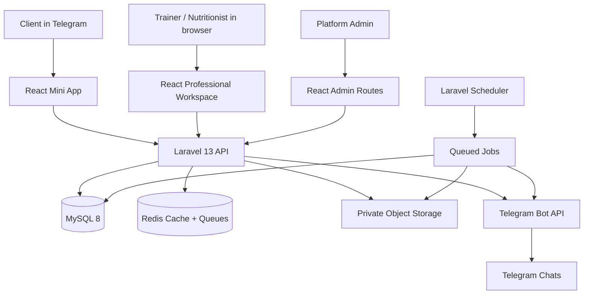

# Telegram-First Coaching Platform — Full Project Plan

**Document version:** 1.0  
**Prepared:** 20 October 2026  
**Product direction:** Complete platform, delivered through dependency-based build stages. This is not an MVP scope cut.

---

## 1. Product definition

Build one coaching platform for personal trainers, nutritionists, and professionals who do both. Professionals manage clients and deliver coaching through a professional workspace. Clients access their assignments, training, nutrition, progress, and coach communication through a Telegram Mini App. A Telegram bot handles entry points, reminders, notifications, and deep links. A platform admin area manages users, content, support, and platform-level settings.

### Product promise

- **For professionals:** manage a client’s entire coaching journey from one place, with less administrative work.
- **For clients:** know what to do today, record it quickly, and get useful feedback from their coach.
- **For the platform operator:** operate the product safely, understand adoption and retention, and manage professional accounts and platform settings.

### Product principles

1. The client’s next action should be obvious on every screen.
2. Logging a workout or meal should require as little typing as possible.
3. Saving must be reliable. Important data should not be lost because Telegram was minimized, the page reloaded, or connectivity dropped.
4. Training and nutrition should share a client profile, calendar, communication thread, reminders, and progress history.
5. Coaches should be able to reuse templates and make client-specific adjustments without silently rewriting historical records.
6. Store sensitive client data with explicit access boundaries, limited retention, and secure media access.
7. Telegram is the primary client entry point, but core business data belongs in the platform database, not only in Telegram messages or Mini App storage.

## 2. Scope: the complete product

### A. Identity, onboarding, and account settings

- Telegram identity validation and account creation/linking.
- Professional login to the browser workspace.
- User roles and permissions: platform admin/support, workspace owner, coach/trainer, nutritionist, assistant, and client.
- Profile setup, professional type, credentials, profile photo, timezone, locale, preferred units, notification preferences, and account status.
- Client onboarding: goals, experience, available equipment, training days, dietary preferences, allergies, relevant limitations, units, and consent.
- Account recovery, session management, revoke sessions, export requests, and account deletion workflows.

### B. Workspaces and professional operations

- Solo professional workspaces and team/studio workspaces.
- Workspace members with explicit roles and permissions.
- Client assignments across trainers and nutritionists, including handover and ending a coaching relationship.
- Professional dashboard: today’s schedule, clients requiring attention, upcoming check-ins, missed sessions, recent activity, and follow-up tasks.
- Client directory with search, filters, status, tags, and saved views.
- Client profile with overview, notes, assigned staff, goals, plans, messages, sessions, measurements, check-ins, and history.
- Private coach notes separated from client-visible messages.
- Client intake forms and configurable check-in forms.
- Data export for clients and the workspace.

### C. Exercise library and training programs

- Built-in exercise taxonomy: muscle group, movement pattern, equipment, difficulty, and training type.
- Exercise details: name, instructions, common mistakes, safety notes, video/GIF/image, alternatives, and regression/progression options.
- Custom exercises per workspace; private or shared library visibility.
- Program templates, program versions, training days, supersets/circuits, warm-ups, cooldowns, rest periods, notes, and exercise prescriptions.
- Prescription fields as appropriate: sets, reps or duration, target load, RPE/RIR, tempo, rest, distance, and coaching notes.
- Program calendar and assignment to an individual or group.
- Program versioning so edits affect future sessions deliberately and old completed sessions retain their original prescription.
- Exercise substitutions and unavailable-equipment alternatives.

### D. Client workout experience

- Today view with the assigned workout and clear next action.
- Workout preview and exercise details.
- Start, pause, resume, skip, replace exercise, and complete workout.
- Set-by-set logging: reps, load, duration, distance, RPE/RIR, and notes where relevant.
- Previous performance beside the current set, with coach-defined progression suggestions.
- Rest timer, optional haptic feedback, workout notes, and session summary.
- Automatic save after set changes, duplicate-submit protection, interrupted-session recovery, and retry behavior for poor connectivity.
- Workout history, personal records, adherence calendar, and progress trends.
- Clear handling of rest days, missed workouts, and plan changes.

### E. Nutrition and habit coaching

- Nutritionist profile and nutrition-specific permissions.
- Food library with portions, serving units, calories, protein, carbohydrates, fat, and optional fiber/sodium fields.
- Nutrition plan templates and client-specific meal plans.
- Meal timing, meal items, serving sizes, substitutions, recipe/instruction notes, and daily targets.
- Food diary with quick-add, recent/favorite foods, meal copying, and manual food entry.
- Daily nutrition summary and adherence against coach-assigned targets.
- Water/hydration tracking and configurable habits.
- Dietary preferences and allergy flags visible when creating a plan.
- Habit assignment, reminders, daily completion, and history.
- Nutrition notes and coach review. The product must not present itself as a diagnosis or emergency medical service.

### F. Goals, measurements, progress photos, and check-ins

- Goals with target value, starting value, due date, and status.
- Body weight, body measurements, performance metrics, and configurable metric types.
- Progress charts with time ranges and consistent unit conversion.
- Private progress photo uploads, timestamps, optional labels, and comparison view.
- Weekly or custom check-in schedules.
- Check-in templates with questions, numeric ratings, free text, adherence questions, and optional photo upload.
- Client submission, coach review, comments, follow-up tasks, and a history of plan adjustments.
- Clear visibility settings so each metric, note, and photo has a defined audience.

### G. Messages, reminders, and notifications

- Persistent in-app coach-client conversations stored in the platform database.
- Text and authorized attachments, message history, read state, and unread counts.
- Telegram bot notifications and deep links to the relevant Mini App screen.
- Reminders for workouts, meals, habits, check-ins, and appointments.
- Notification preferences, quiet hours, timezone-aware scheduling, opt-out controls, retry handling, and delivery logs.
- Coach announcements to a group or selected clients, with privacy protections.
- Optional notification channels behind adapters so email/SMS can be added without rewriting product logic.
- Do not rely on the bot to read arbitrary private Telegram conversations. Treat Telegram delivery and the platform’s message database as separate systems.

### H. Scheduling and coaching workflow

- Professional availability rules, calendar view, session types, appointment duration, buffer time, and cancellation rules.
- Client appointment requests and confirmations, reschedule/cancel flow, and reminders.
- Session notes and appointment history.
- Follow-up task queue for overdue check-ins, stalled clients, missed workouts, and unanswered requests.
- Optional group coaching: cohorts, shared programs, announcements, challenges, participation, and opt-in leaderboards.

### I. Business and platform administration

- Professional and workspace settings.
- Exercise/food content management, categories, and content visibility.
- Platform admin dashboards, user search, account suspension/reactivation, support handling, audit trail, and system configuration.
- Platform plans and entitlements if professionals pay to use the product.
- Billing records and payment-provider adapter boundary if the business model requires collecting subscriptions or client payments.
- Feature flags, usage metrics, application health, notification failures, and queue failures.
- Payment-provider specifics must be selected before implementing real payment flows. Keep the domain independent of any one provider.

## 3. Assumptions and decisions to lock before coding

Use these as defaults unless you deliberately change them. Record changes in `docs/decisions/`.

| Decision | Recommended default | Why |
|---|---|---|
| Backend | Laravel 13, PHP, JSON API | Fits the domain and keeps business rules server-side. |
| Frontend | React + TypeScript + Vite | One codebase can power the Mini App, professional workspace, and admin interface with separate layouts. |
| Database | MySQL 8 | Strong relational fit for plans, assignments, logs, and reporting. |
| Cache/queues | Redis in production | Reliable asynchronous work for Telegram reminders, media jobs, and reports. |
| Client entry | Telegram Mini App | Primary client UX; bot is the entry and reminder channel. |
| Professional entry | Responsive browser workspace | Better for complex client management and plan building on desktop. |
| Admin entry | Protected web routes in same frontend codebase | Reduces duplication; authorization remains server-enforced. |
| Authentication | Validate Telegram `initData` server-side; issue a revocable platform session/token. Professional login uses the same user identity model. | Telegram-provided client data is not trusted until verified. |
| API shape | Versioned REST API `/api/v1` with OpenAPI documentation | Easy to test, document, and consume from React. |
| Media | Private S3-compatible object storage with signed access URLs | Keeps progress photos and private attachments out of public paths. |
| Backend structure | Modular monolith organized by domain | Faster to build and maintain than microservices; supports future extraction. |
| Tests | Pest for Laravel, Vitest for frontend logic, Playwright for end-to-end flows | Covers business rules, UI logic, and complete user journeys. |

### Important scope boundary

The system can support manual payment records and provider-independent billing structures, but real payment collection requires a product decision: are professionals paying the platform, clients paying professionals through the platform, or both? Define fee rules, refund handling, and the payment provider before enabling live payments. This is a decision to make, not a reason to delay the other modules.

## 4. User roles and permission model

Do not authorize access based only on a role label in the frontend. Every protected request must be scoped by the user’s workspace membership and, where relevant, their relationship to the client.

| Role | Main permissions |
|---|---|
| Platform admin | Platform-wide settings, account lifecycle, content administration, system health, and audit access. Sensitive client data should not be casually browsable. |
| Support agent | Limited account/support tools; no default access to private coaching data. Elevated access requires a reason and audit trail. |
| Workspace owner | Workspace settings, members, billing/entitlements, all workspace clients, and reports. |
| Trainer | Assigned clients, training plans, workouts, measurements, check-ins, and communication according to permissions. |
| Nutritionist | Assigned clients, nutrition plans, food logs, nutrition-related measurements/check-ins, and communication according to permissions. |
| Assistant | Explicitly granted tasks, such as scheduling or client administration; no automatic access to sensitive data. |
| Client | Own plans, logs, progress, appointments, profile, and messages; cannot query another client’s data. |

Clients may have more than one assigned professional (for example, a trainer and nutritionist). Model this as relationships, not as a single `coach_id` column on the client profile.

## 5. Recommended architecture



### Architecture rules

- Start as a **modular monolith**, not microservices.
- All plan assignment, permissions, progress, notification scheduling, and billing rules live in Laravel.
- React screens call the API; do not duplicate important business rules in the frontend.
- Use a domain service/action for multi-step business operations, not giant controllers.
- Use Laravel policies for authorization and Form Requests for input validation.
- Generate or maintain typed API contracts from OpenAPI. Avoid hand-maintaining a second source of truth for request/response types.
- Queue slow or retryable tasks: Telegram deliveries, reminders, media processing, exports, reports, and scheduled jobs.
- Use a transactional outbox or equivalent reliable dispatch pattern for important events that must trigger notifications after a database commit.
- Keep storage private by default. Serve private media using short-lived signed URLs after checking the user’s access.

## 6. Repository structure

A monorepo is a practical starting point:

```text
coaching-platform/
  backend/                       # Laravel API and Telegram webhook
    app/
      Domain/
        Identity/
        Workspaces/
        Clients/
        Training/
        Nutrition/
        Progress/
        CheckIns/
        Messaging/
        Scheduling/
        Notifications/
        Billing/
        Administration/
      Http/
        Controllers/Api/V1/
        Middleware/
        Requests/
        Resources/
      Jobs/
      Policies/
      Notifications/
    database/
      migrations/
      factories/
      seeders/
    routes/
      api.php
      web.php
    tests/
  frontend/                      # React + TypeScript + Vite
    src/
      app/                        # router, layouts, providers
      components/                 # shared UI primitives
      features/
        auth/
        onboarding/
        clients/
        exercises/
        training/
        workouts/
        nutrition/
        progress/
        check-ins/
        messaging/
        scheduling/
        notifications/
        billing/
        administration/
      integrations/telegram/
      lib/api/
      lib/validation/
      styles/
    tests/
  docs/
    product/
    architecture/
    decisions/
    api/
    runbooks/
  infra/
    docker/
    nginx/
    monitoring/
```

Use separate React layout shells: `ClientMiniAppLayout`, `ProfessionalLayout`, and `AdminLayout`. Share form controls, typography, cards, loading/error states, and typed API utilities, but do not force all three experiences into the same navigation.

## 7. Domain model and primary database tables

The following is the initial logical model. Add foreign keys, unique constraints, timestamps, indexes, and soft deletion only where the lifecycle requires it. Avoid an unstructured JSON blob for core relationships.

### Identity and workspace

- `users`: account identity, email/login data if supported, account status, locale, timezone, unit preference.
- `telegram_accounts`: `user_id`, unique `telegram_user_id`, Telegram username/profile fields, linked/verified timestamps.
- `professional_profiles`: `user_id`, professional type, bio, credentials, contact/business profile fields.
- `client_profiles`: `user_id`, goals, onboarding state, selected preferences, consent timestamps.
- `workspaces`: name, type (solo/studio), owner, settings.
- `workspace_members`: workspace, user, role, status, permission overrides.
- `professional_client_assignments`: workspace, client, professional, relationship type, permissions, status, start/end dates.
- `client_invites`: workspace, creator, opaque hashed token, expiration, redeemed timestamp, intended role/relationship.
- `client_tags`, `client_tag_assignments`, `client_notes`.

### Training

- `exercise_categories`, `exercises`, `exercise_muscle_groups`, `exercise_equipment`, `exercise_media`, `exercise_alternatives`.
- `training_programs`: owner/workspace, name, description, visibility, lifecycle status.
- `training_program_versions`: version number, created by, published timestamp, change summary.
- `training_days`: version, day/order/title/rest-day configuration.
- `training_day_exercises`: exercise, order, group/superset identifier, prescriptions, notes.
- `program_assignments`: client/group, program version, date range, schedule rules, status.
- `workout_sessions`: assignment, client, actual start/end, status, duration, client feedback, completion source.
- `workout_session_exercises`: historical snapshot of the prescribed exercise and order at the time the session began.
- `workout_sets`: set order, planned and actual reps/load/duration/distance/RPE/RIR, completion state, notes.
- `personal_records` or a derived read model for records; avoid treating a derived cache as the only source of truth.

### Nutrition and habits

- `foods`, `food_portions`, `food_categories`, `recipes`, `recipe_items`.
- `nutrition_plans`, `nutrition_plan_versions`, `nutrition_plan_days`, `meals`, `meal_items`.
- `nutrition_assignments`: client, plan version, start/end dates, status.
- `food_logs`, `food_log_items`: actual consumed food and portion, including custom/manual food entries.
- `nutrition_targets`: source (plan or coach override), target type, value, effective dates.
- `habits`, `habit_assignments`, `habit_logs`.
- `water_logs` or a normalized habit-based water tracking model; choose one consistent representation.

### Progress and check-ins

- `goals`, `goal_updates`.
- `metric_definitions`, `client_metric_entries` with metric value, canonical unit, observed timestamp, source, visibility, and optional note.
- `progress_photos`: private object key, client, timestamp, label, access policy.
- `check_in_templates`, `check_in_questions`, `check_in_schedules`, `check_in_submissions`, `check_in_answers`, `check_in_reviews`.
- `plan_change_events` to explain significant changes to client plans over time.

### Messaging and notifications

- `conversations`, `conversation_members`, `messages`, `message_attachments`, `message_reads`.
- `notification_preferences`, `notification_events`, `notification_deliveries`, `scheduled_reminders`.
- `outbox_events` for reliable post-commit event processing.

### Scheduling, groups, and billing

- `availability_rules`, `appointments`, `appointment_types`, `appointment_events`.
- `coaching_groups`, `group_memberships`, `group_program_assignments`, `challenges`, `challenge_participation`.
- If payments are enabled: `billing_customers`, `subscription_plans`, `workspace_subscriptions`, `invoices`, `payment_transactions`, `refunds`, and provider webhook records. Store provider IDs and raw webhook event IDs for idempotency; do not store raw card data.

### Operations and compliance

- `audit_events`: actor, action, resource type/id, timestamp, request/correlation ID, and reason for sensitive support actions.
- `user_consents`, `data_export_requests`, `deletion_requests`.
- `feature_flags`, `platform_settings`, `support_cases`.

### Data modeling rules

1. Use canonical units in storage (for example, kilograms and centimeters) and convert for display. Store unit metadata when it is necessary to interpret historical data.
2. Store dates and timestamps consistently in UTC; render them in the user’s configured timezone.
3. Preserve history for completed workouts and published plan versions.
4. Use database transactions around operations that create multiple related records.
5. Add indexes based on real access paths: workspace + status, client + timestamp, assignment + scheduled date, user + Telegram ID, and notification delivery status + due time.
6. Avoid deleting records that must remain for audit/history. Use explicit lifecycle statuses and carefully selected soft deletes.

## 8. Main user journeys

### Journey 1: Professional setup and client invitation

1. Professional creates an account and workspace.
2. Sets professional type: trainer, nutritionist, or both.
3. Completes profile, timezone, units, and notification preferences.
4. Creates or selects an intake form.
5. Enters a client name/optional contact or generates a shareable invitation link/QR.
6. Client opens the Telegram bot and Mini App through the invitation deep link.
7. Backend validates Telegram launch data and redeems the invitation exactly once.
8. Client completes onboarding and required consent.
9. Client-professional assignments become active; the professional dashboard shows onboarding completion.
10. The professional assigns a training program, nutrition plan, check-in schedule, and any habits.

**Edge cases to handle:** expired/reused invite, client already registered, client invited by multiple professionals, invite revoked, user declines, incomplete onboarding, and professional no longer has access to the workspace.

### Journey 2: Build and assign a training program

1. Professional searches the exercise library or creates an exercise.
2. Creates a program template and adds days/exercises.
3. Configures prescribed sets, reps, load guidance, duration, rest, RPE/RIR, and coach notes.
4. Saves a draft, previews the client view, then publishes a version.
5. Assigns the specific version to one or more clients, sets schedule/start date, and adds individual overrides if supported.
6. Client sees the plan on their training screen.
7. Changes create a new version or an explicit assignment override; historical workouts are not silently changed.

### Journey 3: Complete a workout reliably

1. Client opens Today and sees the assigned workout.
2. Taps Start; backend creates/resumes the session.
3. Client records each set. The UI shows the previous performance when available.
4. Each change is saved promptly; the interface shows saved/saving/offline/error state.
5. Client can pause, navigate away, return, and resume.
6. Client completes the session and receives a summary.
7. Progress metrics and adherence update; a coach dashboard event is created.
8. Coach is notified according to notification preferences.

**Critical acceptance rule:** reloading or minimizing Telegram must not erase already-saved sets. Retry requests must not create duplicate sets or duplicate completion events.

### Journey 4: Assign and follow a nutrition plan

1. Nutritionist builds a plan from foods, recipes, or manual entries.
2. Reviews allergens and client preferences before publishing.
3. Assigns plan version and nutrition targets to the client.
4. Client opens Nutrition Today, sees meals and serving instructions.
5. Client logs a meal from the plan, favorites/recent foods, or manual entry.
6. Daily summary recalculates from recorded items.
7. Nutritionist reviews adherence and uses it alongside check-in and progress data.

### Journey 5: Weekly check-in and plan adjustment

1. A scheduled job identifies clients whose check-ins are due in their timezone.
2. Bot sends a reminder with a deep link to the correct check-in.
3. Client submits ratings, written answers, and optional permitted progress photos.
4. Coach receives an attention item and reviews the submission.
5. Coach responds, records private notes separately from client-visible feedback, and makes explicit plan changes.
6. The client sees the feedback and an understandable change summary.
7. The check-in is marked reviewed; audit/history retains who reviewed it and when.

### Journey 6: Appointment lifecycle

1. Professional configures availability and appointment types.
2. Client selects a valid slot.
3. Backend checks conflicts within a transaction and creates a pending/confirmed appointment according to workspace settings.
4. Both sides receive confirmation and reminders.
5. Reschedule/cancel creates an appointment event; old values remain in history.
6. Professional can add private session notes after the appointment.

## 9. Frontend screen inventory

### Client Mini App

- Launch/loading/authentication state.
- New-client invitation acceptance.
- Onboarding steps, validation, save-and-resume.
- Today dashboard: next workout, meals, habits, check-in, coach messages.
- Training calendar and program detail.
- Workout execution: overview, exercise, set logging, rest timer, pause/resume, finish summary.
- Exercise library/search and exercise detail.
- Nutrition Today, meal detail, food search, portion entry, food diary, targets, recipe detail.
- Habits and water tracking.
- Progress dashboard, metric entry, charts, private photo upload/comparison.
- Check-in form and submission status/review feedback.
- Messages and attachments.
- Appointments, booking, reschedule, cancel.
- Profile, goals, units, timezone, language, notification preferences, privacy/data controls.
- Empty, loading, offline, retry, permission-denied, and expired-session states for every feature.

### Professional workspace

- Login and workspace selection.
- Today dashboard and attention queue.
- Client directory, saved filters, add/invite client.
- Client profile with Overview, Training, Nutrition, Progress, Check-ins, Messages, Appointments, and History tabs.
- Exercise library: browse, create/edit, media management, tags, alternative exercises.
- Training program list, template editor, weekly/day editor, preview, version history, assignment wizard.
- Nutrition food library, recipes, plan editor, plan version history, assignment wizard.
- Check-in form builder, schedules, submissions inbox, review flow.
- Goals and measurement review.
- Messaging inbox, unread filters, templates/quick replies if needed.
- Calendar, availability, appointment types.
- Groups/challenges, announcements, participation view.
- Reports and exports.
- Workspace members, permissions, settings, billing/entitlements if applicable.

### Platform admin

- System overview and operational health.
- User/workspace search and account lifecycle actions.
- Professional verification or credential review if the product requires it.
- Exercise/food taxonomy and shared content management.
- Support case workflow and auditable limited-access tools.
- Feature flags, platform plans, billing-provider/webhook status where enabled.
- Notification/job failure inspection, failed-job retry, audit logs, and configuration.

## 10. API design

Use `/api/v1` with resource-oriented routes, explicit authorization policies, pagination, filtering, stable error formats, and request validation. Keep response shapes predictable and document them in OpenAPI.

Illustrative route groups:

```text
POST   /api/v1/auth/telegram
POST   /api/v1/auth/logout
GET    /api/v1/me
GET    /api/v1/workspaces
POST   /api/v1/client-invites
POST   /api/v1/client-invites/{token}/redeem
GET    /api/v1/clients
GET    /api/v1/clients/{client}
POST   /api/v1/clients/{client}/assignments
GET    /api/v1/exercises
POST   /api/v1/exercises
GET    /api/v1/programs
POST   /api/v1/programs
POST   /api/v1/programs/{program}/versions
POST   /api/v1/program-assignments
POST   /api/v1/workout-sessions
PATCH  /api/v1/workout-sessions/{session}
POST   /api/v1/workout-sessions/{session}/sets
POST   /api/v1/workout-sessions/{session}/complete
GET    /api/v1/nutrition-plans
POST   /api/v1/nutrition-plans
POST   /api/v1/food-logs
GET    /api/v1/progress/metrics
POST   /api/v1/progress/metrics
POST   /api/v1/progress/photos
GET    /api/v1/check-ins/due
POST   /api/v1/check-ins/{schedule}/submissions
POST   /api/v1/check-ins/{submission}/review
GET    /api/v1/conversations
POST   /api/v1/conversations/{conversation}/messages
GET    /api/v1/appointments/availability
POST   /api/v1/appointments
POST   /api/v1/appointments/{appointment}/reschedule
POST   /api/v1/appointments/{appointment}/cancel
GET    /api/v1/notifications/preferences
PATCH  /api/v1/notifications/preferences
POST   /api/v1/webhooks/telegram
```

This is a naming guide, not a mandate to implement every endpoint exactly as written. Keep commands that change a workflow explicit (complete workout, review check-in, reschedule appointment) rather than hiding important transitions inside generic updates.

### API behavior standards

- Use HTTP status codes consistently and return field-level validation errors.
- Use cursor or page pagination for long lists; never return a workspace’s entire client history by default.
- Use idempotency keys for operations that may be retried from weak connectivity.
- Record correlation IDs for debugging requests across queues and webhook deliveries.
- Apply authorization to list endpoints as carefully as detail endpoints.
- Rate-limit Telegram auth, invite redemption, message sending, uploads, and other abuse-sensitive endpoints.

## 11. Telegram Mini App and bot implementation

### Authentication

1. Frontend sends the raw `Telegram.WebApp.initData` string to the backend.
2. Backend validates the signature using the current Telegram specification and the bot token or approved validation method.
3. Backend rejects stale `auth_date` values beyond the configured tolerance and rejects malformed/replayed authentication as appropriate.
4. Only after validation does the backend create/update the Telegram account and issue a revocable platform session/token.
5. Ignore `initDataUnsafe` for authorization. It is a client-side convenience object, not trusted proof of identity.
6. Apply normal workspace/client authorization after Telegram identity is resolved. A valid Telegram login does not automatically grant access to any client or workspace.

### Launch and deep links

- Configure a main Mini App or menu button for normal opening.
- Use deep-link start parameters for invitations, check-ins, appointments, and notification destinations.
- Treat start parameters as untrusted navigation context; validate invite tokens and resource access on the backend.
- Store bot token only in server-side secret configuration.
- Validate the Telegram webhook secret/token strategy, deduplicate updates, and return quickly; queue longer work.

### UX constraints

- Use Telegram’s BackButton and bottom action button only when it makes the current flow simpler.
- Respect current viewport, stable viewport, safe-area, and content-safe-area values; do not pin bottom actions using a stale viewport height.
- Provide accessible labels and large touch targets.
- Handle dark mode or map Telegram theme variables into the product design tokens.
- Never assume the client will remain open while a job runs. Persist meaningful progress on the backend.
- Test on Telegram Android, iOS, Desktop, and Telegram Web where possible, not only in ordinary Chrome.
- Use Telegram’s dedicated test environment and a separate test bot before production setup.

## 12. Security, privacy, and reliability

### Security baseline

- Strict server-side authentication and authorization; least privilege by workspace, assigned client, and resource.
- Form Request validation, escaped output, safe file-type/size checks, rate limits, and CSRF/session protections appropriate to the auth method.
- Private file storage with signed URLs and access checks on every private download.
- Encrypt secrets in environment/secret manager; never expose the Telegram bot token to React.
- Audit sensitive actions: role changes, client export, photo access by support, account suspension, plan changes, and billing operations.
- Use database transactions for invitation redemption, booking conflict checks, workout completion, and subscription state changes.
- Validate webhook signatures/secrets, make webhook handlers idempotent, and store provider event IDs.
- Never log raw auth tokens, bot tokens, sensitive food/health notes, or private photo URLs.

### Privacy and client trust

- Explain what the coach can see before a client submits sensitive information.
- Separate coach-private notes from client-visible feedback.
- Make photo and metric visibility explicit.
- Implement data export and account-deletion request workflows.
- Define retention and backup restoration policy.
- Collect only what the coaching product needs; do not claim medical outcomes or emergency monitoring.

### Reliability baseline

- User-visible save state: saving, saved, pending/offline, and failed with retry.
- Server-side durable records for completed actions.
- Idempotent jobs and notification deliveries.
- Retry/backoff and dead-letter or failed-job inspection.
- Backups with tested restoration, not just enabled backups.
- Error monitoring and health checks for API, database, queues, scheduler, storage, and Telegram webhook delivery.

## 13. Testing strategy

### Backend automated tests

- Telegram `initData` valid signature, invalid signature, stale data, malformed data, and repeated login cases.
- Workspace and relationship authorization for every resource category.
- Invite expires/redeems once and handles existing accounts correctly.
- Program version editing does not alter historical workout sessions.
- Workout set writes are idempotent; paused sessions can resume; completion can happen once.
- Food portions and nutrient calculations use consistent units and rounding.
- Metric unit conversions and historical chart data.
- Check-in timing across timezones and daylight/time changes where relevant.
- Appointment overlap/conflict protection under concurrent requests.
- Notification retries, user preferences, quiet hours, and duplicate webhook/job handling.
- Admin/support actions are audited.

### Frontend tests

- Form validation and error handling.
- Workout logging state machine and unsaved/offline states.
- Client onboarding and invitation acceptance.
- Exercise/program editor behavior and validation.
- Nutrition diary totals and quick-add interactions.
- Navigation/back behavior in the Mini App shell.
- Responsive layouts and accessibility labels.

### End-to-end tests

Test these journeys on a staging environment with a test bot:

1. Professional signs up, creates a workspace, invites a client, and assigns a plan.
2. Client accepts the invite and completes onboarding.
3. Client starts a workout, logs sets, reloads/minimizes, resumes, and completes it.
4. Nutritionist assigns a plan; client logs food; totals and coach view update.
5. Client submits a check-in; coach reviews it; client sees feedback.
6. Client books and reschedules an appointment; reminders reflect the latest slot.
7. Client loses access when a relationship ends and retains only data they are permitted to access.
8. A bot send failure is retried without duplicate messages or state transitions.

## 14. Implementation roadmap — complete scope, dependency order

These stages do not define different product releases or remove features. They order implementation so the full system can be built safely and consistently.

### Stage 0 — Product and technical contracts

- Create this plan in version control.
- Write short product specs for every module and flow.
- Draw ERD and permission matrix.
- Decide payment scope and concrete gateway(s); define what information professionals and clients can see.
- Define design tokens, navigation shells, component conventions, API error format, timezone/unit policy, and statuses.
- Create `docs/decisions/` and record decisions such as authentication and versioning.

**Gate:** scope, relationship/permission model, data ownership, and API conventions are written down.

### Stage 1 — Repository, infrastructure, and quality gates

- Set up Laravel API, React/Vite TypeScript frontend, lint/type-check, test runners, formatting, and CI.
- Configure local environment with MySQL and Redis; use containers if helpful for consistent setup.
- Configure environment examples, secrets strategy, storage adapter, queue connection, scheduler, and logging.
- Establish API docs and `/health` checks.
- Create staging and production environment plans.

**Gate:** fresh clone can be installed from documented instructions; CI runs tests and static checks.

### Stage 2 — Identity, Telegram integration, workspaces, and access control

- Implement accounts, Telegram linkage, server-side `initData` validation, revocable sessions, and logout.
- Implement professional browser authentication and account-linking flow.
- Build workspaces, members, roles, policies, and audit events.
- Implement client invitations, redemption, relationship states, and onboarding.
- Build client/professional/admin layout shells and empty/loading/error states.

**Gate:** end-to-end auth and client invite flow work; unauthorized cross-workspace and cross-client access tests pass.

### Stage 3 — Client directory and professional dashboard

- Build client list, search, filters, tags, saved views, client profile, notes, status, and assignment lifecycle.
- Build Today dashboard, attention queue, recent activity, and client follow-up tasks.
- Add shared UI for status chips, empty states, confirmation dialogs, date/time display, and pagination.

**Gate:** professional can invite, view, search, assign, hand over, pause, and end a client relationship safely.

### Stage 4 — Exercise library and training program authoring

- Build taxonomy, exercise CRUD, custom exercises, media upload, and alternatives.
- Build program templates, day/exercise ordering, all prescription fields, validation, draft/publish flow, and version history.
- Build assignment wizard, scheduling rules, per-client overrides, and preview.
- Create seed data for categories and a small licensed/sample exercise set for development.

**Gate:** a coach can create a program, publish a version, assign it, and see exactly that version from the client account.

### Stage 5 — Workout execution and progress primitives

- Build workout session lifecycle, exercise snapshot, set logging, rest timer, previous performance, pause/resume, finish summary, and history.
- Implement autosave, idempotency, recovery, offline/retry UI, and server reconciliation.
- Add goals, metric definitions/entries, canonical units, personal records, and progress dashboard foundations.

**Gate:** workout logs survive reload/reconnect, duplicate submissions are safe, and historical workouts remain consistent after plan changes.

### Stage 6 — Nutrition plans, food library, and habits

- Build food and portion database, custom foods, recipes if included, nutrient calculation service, and food search.
- Build nutrition plan templates/versions, meal editor, daily targets, assignments, and client-specific notes.
- Build food diary, quick-add/recent foods/favorites, water tracking, habit assignments/logs, and adherence summary.
- Surface dietary preferences/allergies to authorized professionals during plan creation.

**Gate:** assigned meals, logged foods, daily totals, targets, and professional view agree under unit and portion tests.

### Stage 7 — Check-ins, photos, coach review, and communication

- Build configurable check-in forms, scheduling rules, submissions, reviews, plan-change events, and photo access rules.
- Implement secure media upload and signed delivery.
- Build persistent conversation/message model, attachments, read state, notification preferences, and Telegram delivery service.
- Add templates/quick replies only after the core inbox and message states are reliable.

**Gate:** a submitted check-in appears in the proper professional’s queue, cannot be read by unrelated users, and produces one notification per intended event.

### Stage 8 — Reminders, appointments, calendar, and group coaching

- Configure Laravel Scheduler and queue jobs by category/priority.
- Build user timezone-aware reminders, quiet hours, retries, delivery logs, opt-outs, and deep links.
- Build professional availability, appointment booking, conflict handling, rescheduling, cancellations, reminders, and session notes.
- Build groups, group membership, program assignments, challenges, and announcements if kept in the agreed scope.

**Gate:** reminder timing respects user preferences; appointment conflicts cannot create overlapping confirmed bookings; group data is private to members and authorized staff.

### Stage 9 — Business operations and admin

- Build workspace settings, members/permissions UI, reports, and exports.
- Build admin user/workspace support tools and audit log viewer.
- Build content/taxonomy admin for exercises and foods.
- Implement platform plans/entitlements and the chosen payment adapter if the business model requires it.
- Build billing webhook idempotency, refund/failure states, and billing history if payments are enabled.

**Gate:** admin tasks are permissioned and auditable; paid entitlements cannot be bypassed by client-side checks.

### Stage 10 — Full-system hardening and launch readiness

- Run automated tests and the complete end-to-end journey matrix.
- Test Mini App on Android, iOS, Telegram Desktop, and Telegram Web as available.
- Test slow/interrupted connection, expired session, duplicate webhook, storage outage, queue outage, and Telegram API failure.
- Validate backups and restore procedure.
- Configure production TLS, secrets, deployment, queue workers, scheduler, database migrations, monitoring, alerts, and rollback.
- Review privacy copy, consent, deletion/export, retention, support playbook, incident process, and production support permissions.
- Run a full operational rehearsal using seeded accounts and scripted journeys.

**Gate:** every defined module has acceptance tests, no critical security/reliability issue remains open, monitoring and restore paths are proven, and the full release checklist is signed off.

## 15. Technical implementation rules

### Laravel

- Group business logic by domain, keeping controllers thin.
- Use policies for resource access, Form Requests for validation, API Resources for response shapes, and database transactions for multi-record workflows.
- Keep third-party integrations behind services/adapters: Telegram, storage, payment provider, and optional notification channels.
- Queue retryable work. Specify timeout, retry/backoff, idempotency, and failure handling for each job type.
- Use model factories and seeders to make test setup repeatable.
- Add indexes after considering actual filters/sorts and validate query performance with realistic data.

### React and TypeScript

- Use strict TypeScript; avoid `any` for API responses and domain models.
- Organize code by feature, not by a large global pile of components.
- Keep remote/server state in a query cache; keep only ephemeral UI state locally.
- Define form schemas, empty/loading/error states, and permission-denied states alongside each feature.
- Use reusable design tokens and components, but preserve the separate information architecture for the three audiences.
- Keep workout draft recovery resilient. Never treat browser storage as the only durable copy of a completed session.

### Data and performance

- Use server pagination and filtering for lists.
- Avoid N+1 queries in client overview and dashboard queries.
- Cache stable, frequently used shared content (such as the exercise catalogue) with clear invalidation.
- Avoid overfetching complete workout/nutrition histories on every app open.
- Queue image/video processing and report generation.
- Add database constraints for unique Telegram IDs, invitation token hashes, idempotency keys, and external webhook IDs.

## 16. Design system and interaction contracts

Use the established clean, bright, clinical visual direction as the default: white surfaces, pale neutral canvas, deep green primary action, dark readable text, restrained colors, rounded but not oversized cards, consistent spacing, and large mobile touch targets.

Define shared tokens for color, spacing, typography, radius, elevation, status colors, focus rings, and disabled states. Use labels for inputs, visible field-level errors, and keyboard/screen-reader-friendly semantics.

### Required interaction states on every data screen

- Initial loading/skeleton.
- Loaded state.
- Empty state with one obvious next action.
- Validation error.
- Permission denied/not assigned.
- Network unavailable or request failed with retry.
- Saving/saved state for edits.
- Stale/conflict state when the server changed since the screen loaded.
- Confirmation for destructive or irreversible actions.

### Client UX rules

- Today is the default landing screen.
- Make the main action prominent and avoid competing primary buttons.
- Let users log from the assigned plan rather than search from scratch.
- Show the last performance alongside a set where useful.
- Do not require users to fill every optional value before completing a workout.
- Display which content is coach-provided versus client-entered.

### Professional UX rules

- Start with today’s actions and clients needing attention.
- Support search, filters, bulk assignment where safe, and reusable templates.
- Show the plan version and assignment status clearly.
- Separate private notes from client-visible feedback in both layout and API response shape.
- Make changes and reminders explicit, previewable, and auditable.

## 17. Launch acceptance checklist

### Product completeness

- [ ] Every module in Section 2 has an implemented workflow, not only a placeholder screen.
- [ ] All key client and professional flows have success, empty, loading, validation, and failure states.
- [ ] Roles, workspaces, and client relationships behave as specified.
- [ ] Training and nutrition plans can be created, versioned, assigned, followed, and reviewed.
- [ ] Workout logging, meals, habits, progress, check-ins, messaging, reminders, and appointments work end to end.
- [ ] Admin operations, content management, audit trails, and reports work with strict permissions.
- [ ] Billing and live payment paths, if in scope, use the selected provider and have failed/refund paths.

### Security and data

- [ ] Telegram launch data is validated server-side; `initDataUnsafe` is never trusted for authorization.
- [ ] Cross-workspace and cross-client authorization tests pass.
- [ ] Private attachments/photos are not publicly retrievable without authorization.
- [ ] Secrets and auth tokens are not exposed in frontend builds or logs.
- [ ] Sensitive support actions are audited.
- [ ] Exports/deletion requests and consent state have a defined workflow.

### Reliability

- [ ] Workout data persists across reload/minimize/reconnect.
- [ ] Retried requests and webhook deliveries do not create duplicate state changes.
- [ ] Queue failures and Telegram delivery failures can be inspected and retried safely.
- [ ] Backup restoration has been tested.
- [ ] Production alerting covers API, database, queues, scheduler, storage, and webhook errors.

### Operational readiness

- [ ] Production and staging use separate secrets, bots, and storage paths.
- [ ] Database migrations and deployments are repeatable.
- [ ] Queue workers and scheduler are supervised in production.
- [ ] Logs contain correlation IDs without exposing private content.
- [ ] A rollback and incident response procedure is documented.

## 18. First 15 implementation tasks

Start here. These tasks establish the building blocks for the full platform; they do not limit the planned feature set.

1. Create the repository and add this plan under `docs/product/`.
2. Write the first architecture decision records: stack, auth/session strategy, workspace model, unit/timezone rules, media access, and payment boundary.
3. Draw the initial ERD from Section 7 and review relationships/constraints before making migrations.
4. Initialize the Laravel backend and React/Vite TypeScript frontend.
5. Add CI for backend tests, frontend lint/typecheck, and frontend tests.
6. Create local services for MySQL, Redis, and object storage compatible with the eventual production adapter.
7. Configure API response format, validation errors, pagination, correlation IDs, and health endpoint.
8. Implement users, Telegram account linkage, and server-side Telegram `initData` verification tests.
9. Implement workspaces, membership roles, policies, and audit events.
10. Implement client invitation creation/redemption with expiration and one-time use.
11. Build frontend auth bootstrap and the three layout shells.
12. Implement the complete invitation-to-client-onboarding flow.
13. Seed realistic development users, workspaces, clients, and exercises through factories/seeders.
14. Implement client directory/profile and professional Today dashboard.
15. Add a staging bot and verify the first full journey on real Telegram clients before expanding into training authoring.

## 19. What to build first in the codebase

The first vertical slice should be **identity + workspace + invite + client onboarding**, not because the rest of the product is excluded, but because every other feature depends on knowing who the user is, which workspace they belong to, which professionals can see their data, and whether the client relationship is valid.

After that, build the platform in the roadmap order. Avoid starting with a beautiful program builder before authentication, access control, and assignment lifecycles are stable; otherwise the same screens and data models will need to be rewritten later.

## 20. Official technical references

- Telegram Mini Apps documentation: https://core.telegram.org/bots/webapps
- Laravel 13 routing and API setup: https://laravel.com/framework/docs/13.x/routing
- Laravel 13 queues: https://laravel.com/framework/docs/13.x/queues.
- React documentation: https://react.dev/
- React TypeScript guide: https://react.dev/learn/typescript

Use current official documentation as the source of truth when implementing Telegram launch validation, Bot API methods, framework configuration, and deployment behavior. Telegram evolves its Mini App APIs, so verify the supported client version and behavior before relying on optional device features.
